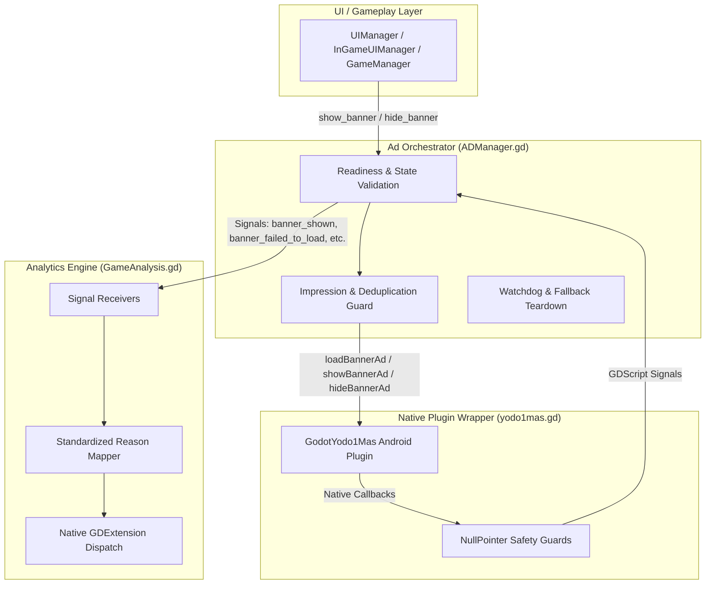
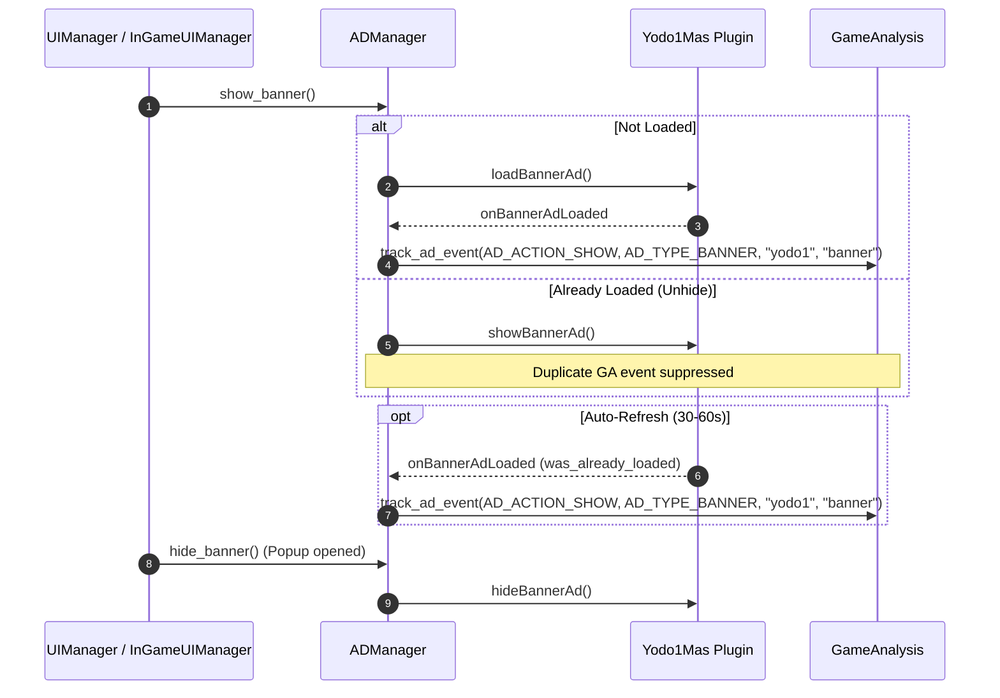

# Banner Ad & Monetization Lifecycle Guide

This document details the unified ad management architecture, native Android plugin integration (Yodo1 MAS), GameAnalytics tracking pipeline, impression deduplication, and failure/stuck-view mitigation strategies implemented in ZeroAimZone.

---

## 1. System Architecture Overview

The advertising layer is designed as a decoupled, signal-driven pipeline:



---

## 2. Banner Ad Lifecycle & Deduplication

### 2.1 Single Impression Per Unique Ad Creative
- **The Problem:** In mobile games, banner ads are hidden when players open menus, settings, stores, or pause popups, and reshown when returning to gameplay. Firing a GameAnalytics `show` event every time the same cached banner is unhidden skews fill/impression metrics and causes duplicate event warnings.
- **The Fix:**
  - `_banner_impression_logged` flag in `ADManager.gd` tracks whether the currently loaded banner creative has already been logged.
  - When returning from a popup, `showBannerAd()` makes the existing view visible, but suppresses duplicate `banner_shown` / GameAnalytics events.
  - When Yodo1 MAS performs an automatic background refresh (every 30–60s), `_on_banner_ad_loaded` detects that an ad was already loaded, emits `banner_refreshed`, and cleanly records the new impression.

### 2.2 Banner Impression Lifecycle Flow



---

## 3. Stuck Banner & Invalid Request Prevention

### 3.1 Immediate Force-Hide on Failure
If a banner fails to load (e.g., `no_fill` / `-600204`) or fails to open (e.g., `invalid_placement` / `-600202`):
1. `_on_banner_ad_failed_to_load` and `_on_banner_ad_failed_to_open` immediately invoke native `hideBannerAd()`.
2. All state flags (`_is_banner_currently_shown`, `_is_banner_loaded`, `_banner_impression_logged`) are synchronously cleared.
3. This prevents blank, black, or unresponsive banner containers from remaining visible over gameplay.

### 3.2 Modal Popup & Screen State Guard
`_is_banner_allowed_right_now()` ensures banners are only visible when permitted:
- Returns `false` if `has_remove_ads()` is active or if any modal popup in `UIManager.popup_panel` or `InGameUIManager.popup_panel` is visible (`popup_panel.is_popup_visible()`).
- `_force_hide_banner_if_not_allowed()` acts as a synchronous fallback before displaying any banner.

---

## 4. GameAnalytics Ad Error Mapping

GameAnalytics native SDK (`libGodotGameAnalytics.so` / `GAAdError`) enforces exact lowercase enum identifiers for ad failure reasons. Passing arbitrary error strings causes the native SDK to fall back to `unknown`.

### 4.1 Standardized Error Reason Mapping

`GameAnalysis._map_ga_no_ad_reason(reason)` maps all internal SDK and network error codes to valid GameAnalytics reasons:

| Yodo1 / Engine Error | Error Codes / Constants | GameAnalytics `ad_fail_show_reason` | Explanation |
| :--- | :--- | :--- | :--- |
| **No Fill / Inventory** | `-600204`, `600204`, `1001`, `"no_fill"` | **`no_fill`** | Ad network has no available ad inventory. |
| **Invalid Request / Config** | `-600202`, `600202`, `1004`, `"plugin_unavailable"`, `"disabled"` | **`invalid_request`** | Placement ID issue, duplicate call, or plugin disabled. |
| **Network & Timeout** | `load_timeout`, `-600200`, `600200`, `1002`, `"network_lost"` | **`offline`** | Network disconnected or 10s load timeout elapsed. |
| **Not Ready / Expired** | `2001`, `2002`, `"ad_not_ready"`, `"ad_expired"`, `"ads_unavailable"` | **`unable_to_precache`** | Ad requested before precache completed or expired. |
| **SDK / Native Crash** | `-600201`, `600201`, `1003`, `"load_threw"`, `"show_threw"` | **`internal_error`** | Native exception or uninitialized SDK. |

### 4.2 GDExtension Dictionary Payload
The native Godot GameAnalytics GDExtension specifically inspects the lowercase **`"reason"`** dictionary key:

```gdscript
var params = {}
if not no_ad_reason.is_empty() or action_str == "failed_show":
    var mapped_reason := _map_ga_no_ad_reason(no_ad_reason)
    params["reason"] = mapped_reason
    params["noAdReason"] = mapped_reason
    params["no_ad_reason"] = mapped_reason
ga.addAdEvent(action_str, type_str, ad_sdk_name.to_lower(), resolved_placement, params)
```

---

## 5. Native Yodo1 MAS Crash Prevention

### 5.1 NullPointer Safety Guard in `yodo1mas.gd`
In the Android Java plugin (`GodotYodo1Mas.aar`), `bannerAdView` is `null` until `loadBannerAd()` is called. Calling `showBannerAd()` or `hideBannerAd()` before initialization triggers:
```
java.lang.NullPointerException: Attempt to invoke virtual method 'int com.yodo1.mas.banner.Yodo1MasBannerAdView.getVisibility()' on a null object reference
```
- **Fix:** `yodo1mas.gd` maintains `_banner_created: bool` and gates `showBannerAd()` and `hideBannerAd()`:
  ```gdscript
  func showBannerAd() -> void:
      if _yodo1mas_singleton != null and _banner_created:
          _yodo1mas_singleton.showBannerAd()

  func hideBannerAd() -> void:
      if _yodo1mas_singleton != null and _banner_created:
          _yodo1mas_singleton.hideBannerAd()
  ```

---

## 6. Verification & Validation Checklist

- [x] **No Duplicate Events:** Unhiding a cached banner does not fire repeated GameAnalytics `show` events.
- [x] **Accurate Refreshes:** SDK background ad refreshes fire single `banner_refreshed` events.
- [x] **No Stuck Banners:** Native banner view is force-hidden on any failure, error, or UI screen transition.
- [x] **Exact Failure Tracking:** All ad failures report clean reasons (`no_fill`, `invalid_request`, `offline`) instead of `unknown`.
- [x] **Zero NullPointerExceptions:** Native view calls are safely guarded against uninitialized references.
- [x] **Signal Argument Parity:** All signal listeners (`_on_interstitial_ad_failed_to_load`, `_on_banner_ad_failed_to_load`, `_on_banner_ad_failed_to_open`) match exact parameter counts.
